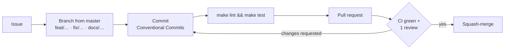

# Contributing

Thanks for helping improve the project. This guide covers the workflow; the
technical details are in the [development guide](docs/development.md).

By participating you agree to follow the [Code of Conduct](CODE_OF_CONDUCT.md).
For security problems, follow the [security policy](SECURITY.md) instead of
opening an issue.

## Ways to contribute

| Contribution | Start with |
| :-- | :-- |
| Bug report | [Bug report form](../../issues/new?template=bug_report.yml) |
| Feature or model improvement | [Feature request form](../../issues/new?template=feature_request.yml) |
| Documentation | A pull request directly; no issue needed for small fixes |
| Code | Comment on an issue first so that the work is not duplicated |

## Workflow



1. **Set up** once:
   ```bash
   uv sync
   uv run pre-commit install
   ```
2. **Branch** from an up-to-date `master` with a prefixed name:
   `feat/batch-anomaly-endpoint`, `fix/psi-empty-bins`, `docs/runbook-rollback`.
3. **Make the change**, with tests. Coverage must stay at or above 80%.
4. **Check locally:**
   ```bash
   make lint && make test
   ```
5. **Open a pull request** and fill in the template. CI must pass and at least
   one maintainer must approve.

## Commit messages

Use [Conventional Commits](https://www.conventionalcommits.org/):

```text
<type>(<optional scope>): <imperative summary>

<optional body: what and why>
```

| Type | Use for |
| :-- | :-- |
| `feat` | New capability |
| `fix` | Bug fix |
| `docs` | Documentation only |
| `refactor` | Code change with no behaviour change |
| `perf` | Performance |
| `test` | Tests only |
| `ci` / `build` | Workflows, Docker, dependencies |
| `chore` | Maintenance |

Mark breaking changes with `!` (`feat(api)!: …`) and a `BREAKING CHANGE:` footer.

## Changes that need extra care

> [!CAUTION]
> **Model or data-contract changes.** Anything that touches features,
> categories, the leakage quarantine or hyperparameters must include:
> - before/after test metrics (link the MLflow runs, or paste the
>   `uv run dvc metrics diff` output);
> - the regenerated `models/serving_contract.json` and `reports/` from
>   `uv run dvc repro`;
> - updates to the [data contract](docs/data-contract.md) and
>   [model card](docs/model-card.md).

> [!IMPORTANT]
> **API changes.** Update the [API specification](docs/api-spec.md) and
> `tests/test_api.py`. Adding or removing a request field is a breaking change.

Also update [`CHANGELOG.md`](CHANGELOG.md) under **Unreleased** for any
user-visible change.

## Reporting model-quality issues

Model errors are bugs too. Please include the request payload (with synthetic
or de-identified values only), the `model_version` from the response, the
expected outcome and why you expect it.

> [!WARNING]
> Never paste real patient data into issues, pull requests or commits.
