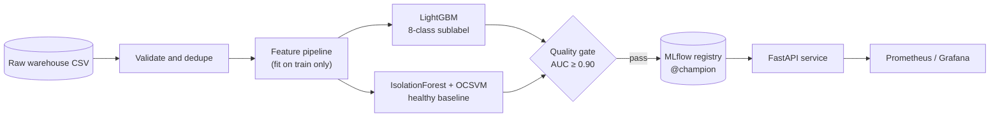

<div align="center">

# Multi-Class Disease Detection & Early-Warning Anomaly Pipeline

**Predicts a patient's comorbidity profile from routine biomarkers and flags how far
they deviate from a healthy baseline, served behind a monitored API.**

[](https://github.com/amulyagavankar20-glitch/Data_Warehouse_Multiclass/actions/workflows/ci.yml)


[](LICENSE)
[](https://www.conventionalcommits.org/)

</div>

---

## Overview

The model assigns each patient one of eight **sublabels**, which are combinations of
three conditions:

| Code | Condition | Sublabels containing it |
| :-- | :-- | :-- |
| `DI` | Diabetes | `DI`, `DI_HT`, `DI_HY`, `DI_HT_HY` |
| `HT` | Heart disease | `HT`, `DI_HT`, `HT_HY`, `DI_HT_HY` |
| `HY` | Hypertension | `HY`, `DI_HY`, `HT_HY`, `DI_HT_HY` |
| `N` | Healthy baseline | `N` |

Alongside the sublabel, two anomaly detectors trained only on healthy patients
score how far each patient deviates from a healthy profile. This works as an
early-warning signal that does not depend on a diagnosis label.



## Results

Held-out test set: **41,806 patients** that were never used for training,
early stopping or calibration.

| Metric | Value |
| :-- | --: |
| Macro one-vs-rest ROC-AUC | **0.944** |
| Macro F1 / weighted F1 | 0.426 / 0.715 |
| Accuracy | 0.708 |
| Disease AUC: Diabetes · Heart disease · Hypertension | 1.000 · 0.926 · 0.805 |
| Early-warning AUC (abnormal vs `N`): IsolationForest · OCSVM | 0.813 · 0.824 |
| p50 latency, single `/predict` | ≈ 13 ms |

> [!IMPORTANT]
> Earlier versions of this project reported **1.00 F1**. That result came from
> target leakage: the columns `diabetes`, `hypertension`, `heart_disease` and
> `disease_flags` restate the label. They are now quarantined, and the numbers
> above are the honest, reproducible baseline. See the
> [model card](docs/model-card.md) for per-class results and limitations.

## Quick start

> [!NOTE]
> Requires [uv](https://docs.astral.sh/uv/). It installs Python 3.11 and the
> exact dependency versions from `uv.lock`.

```bash
uv sync                 # install
make test               # 80 tests, 80% coverage gate
make train              # train, evaluate, gate and register (~2 min)
make serve              # API at http://localhost:8000/docs
```

```bash
curl -s -X POST localhost:8000/predict \
  -H 'content-type: application/json' \
  -d @docs/examples/patient.json
```

To run the full stack (Postgres, MLflow, Prefect, API, Prometheus, Grafana):

```bash
cp .env.example .env
docker compose up -d --build
docker compose --profile train run --rm trainer
```

## Documentation

| Document | Contents |
| :-- | :-- |
| [Architecture](docs/architecture.md) | Components, training and serving flows, model lifecycle, design decisions |
| [API specification](docs/api-spec.md) | Endpoints, request/response schemas, error codes, examples |
| [Data contract](docs/data-contract.md) | Input schema, validation rules, leakage quarantine, feature contract |
| [Model card](docs/model-card.md) | Intended use, metrics per class, limitations, ethical considerations |
| [Operations runbook](docs/operations.md) | Deploy, retrain, promote, roll back, alerts, drift response |
| [Development guide](docs/development.md) | Local setup, testing, conventions, CI, contributing |

## Tech stack

| Layer | Choice |
| :-- | :-- |
| Modelling | LightGBM, scikit-learn |
| Orchestration | Prefect 3 |
| Tracking & registry | MLflow 2 (Postgres backend, alias-based promotion) |
| Pipeline versioning | DVC |
| Serving | FastAPI + uvicorn, non-root multi-stage Docker image |
| Monitoring | Prometheus, Grafana, PSI drift CLI |
| CI/CD | GitHub Actions, Trivy, GHCR |
| Quality | ruff, black, mypy, pytest (97% coverage), pre-commit |

## Repository layout

```text
src/
├── config.py            settings + frozen feature contract
├── data/                loader · validator · stratified splitter
├── features/            ClinicalFeaturePipeline (same code in training and serving)
├── models/              LightGBM champion · IsolationForest · OCSVM · evaluator
├── monitoring/          PSI drift reference + CLI
├── serving/             ModelBundle · MLflow pyfunc wrapper
├── api/                 FastAPI app + schemas
└── utils/               MLflow tracking, registration, promotion
flows/training_flow.py   Prefect training flow
tests/                   unit + integration tests
docs/                    project documentation
reports/                 latest metrics, drift, anomaly audit (git-tracked)
*.ipynb                  research notebooks (EDA, model benchmark)
```

## Contributing & community

| | |
| :-- | :-- |
| [Contributing guide](CONTRIBUTING.md) | Workflow, commit conventions, PR checklist |
| [Code of Conduct](CODE_OF_CONDUCT.md) | Contributor Covenant 2.1 |
| [Security policy](SECURITY.md) | Private vulnerability reporting, hardening notes |
| [Support](SUPPORT.md) | Where to get help |
| [Changelog](CHANGELOG.md) | Release history |
| [Citation](CITATION.cff) | How to cite this project |

## License

The code and documentation are released under the [MIT License](LICENSE).

> [!WARNING]
> The license does **not** cover the dataset in `data/`, which remains subject
> to the terms of its original source. Model artifacts trained on it inherit
> those terms. This software is not a medical device; see the
> [model card](docs/model-card.md).
