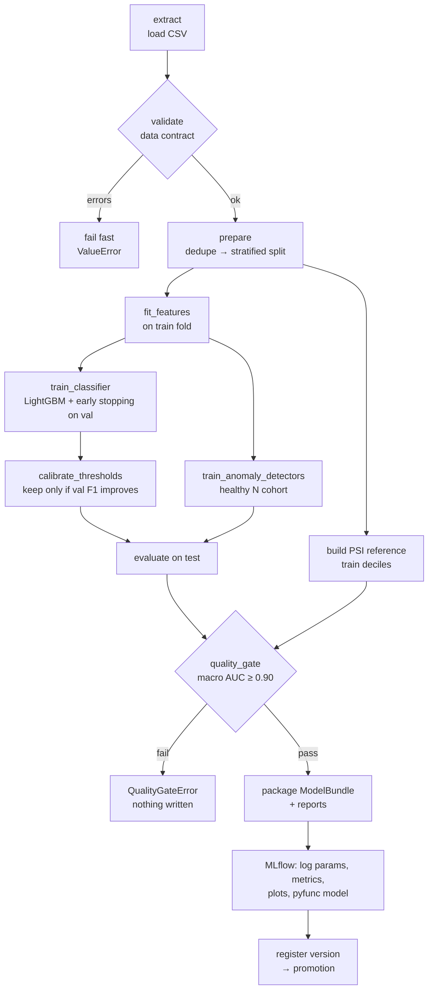
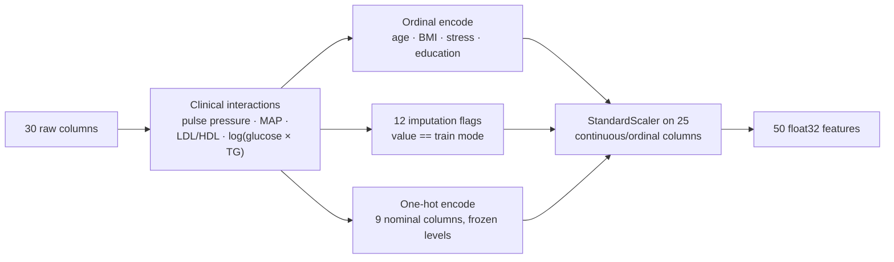
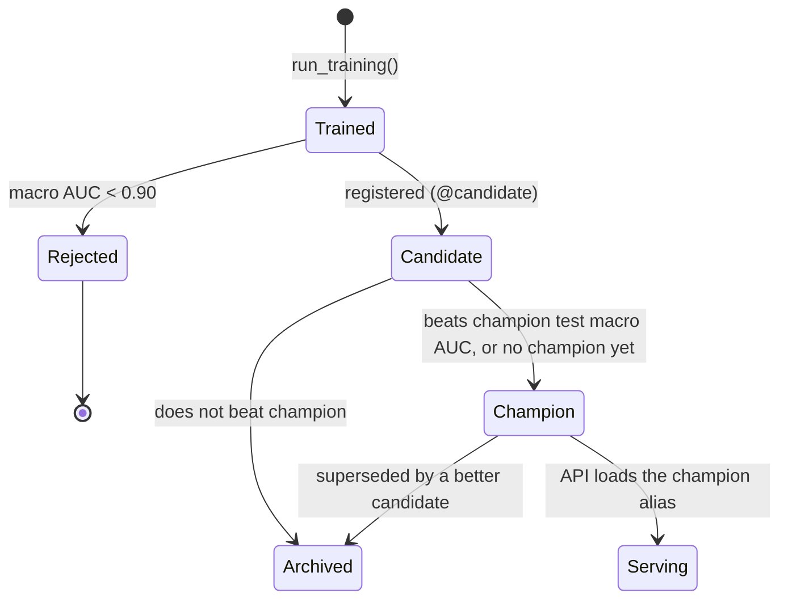
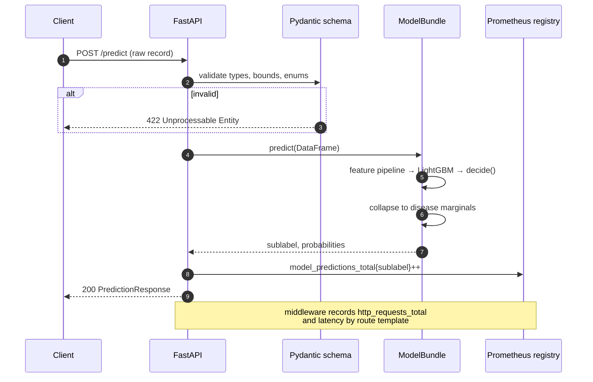
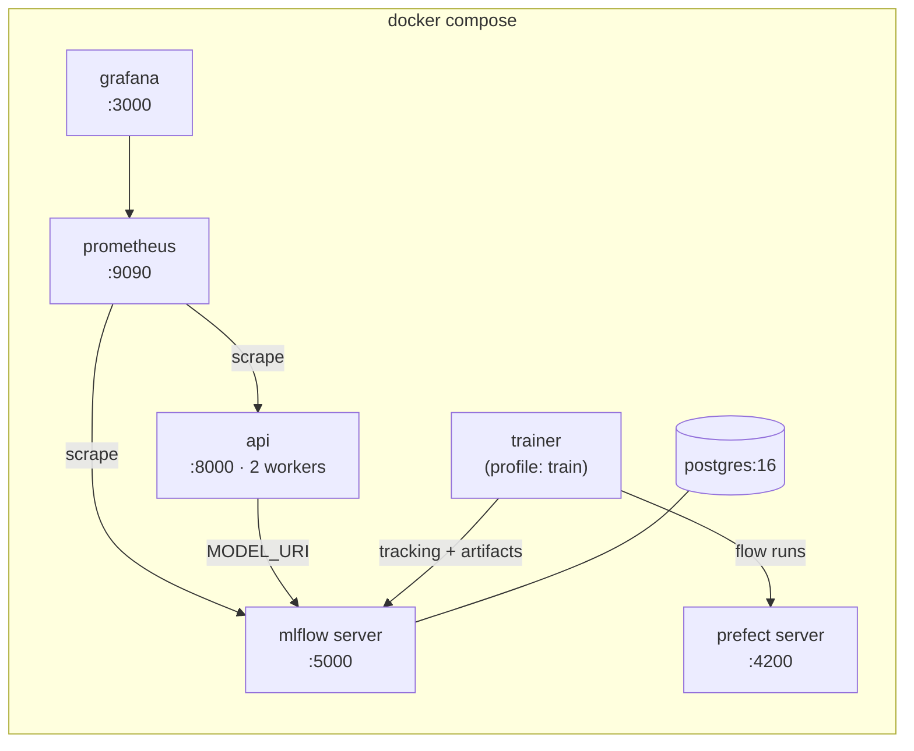

# Architecture

This document describes how the system is put together, how a model moves from
raw data to production, and why the main design decisions were made.

- [System context](#system-context)
- [Components](#components)
- [Training pipeline](#training-pipeline)
- [Feature pipeline](#feature-pipeline)
- [Model lifecycle](#model-lifecycle)
- [Serving path](#serving-path)
- [Observability](#observability)
- [Deployment topology](#deployment-topology)
- [Design decisions](#design-decisions)

---

## System context

```mermaid
flowchart TB
    subgraph Sources
        WH[("Clinical data warehouse<br/>CSV export")]
    end

    subgraph Training["Training plane"]
        PF["Prefect flow"]
        DVC["DVC pipeline"]
        GHA["GitHub Actions<br/>retrain.yml"]
    end

    subgraph Registry["Model registry"]
        ML[("MLflow<br/>Postgres + artifact store")]
    end

    subgraph Serving["Serving plane"]
        API["FastAPI service"]
    end

    subgraph Observability
        PROM["Prometheus"]
        GRAF["Grafana"]
        DRIFT["PSI drift CLI"]
    end

    CLIENT(["Client applications"])

    WH --> PF
    DVC --> PF
    GHA --> PF
    PF -->|"log, register, promote"| ML
    ML -->|"models:/…@champion"| API
    CLIENT -->|"HTTPS / JSON"| API
    API -->|"/metrics"| PROM --> GRAF
    WH -.->|"new batches"| DRIFT
    ML -.->|"drift reference"| DRIFT
```

## Components

| Component | Module | Responsibility |
| :-- | :-- | :-- |
| Settings | `src/config.py` | Runtime settings (env-overridable) and the frozen feature contract |
| Loader | `src/data/loader.py` | Read the CSV, drop duplicates, separate predictors from targets |
| Validator | `src/data/validator.py` | Schema, null, range, category and class-presence checks |
| Splitter | `src/data/splitter.py` | Stratified 70 / 15 / 15 train / validation / test split |
| Feature pipeline | `src/features/engineering.py` | Raw record → 50-column model matrix; fitted on train only |
| Classifier | `src/models/classifier.py` | Cost-sensitive LightGBM, early stopping, guarded threshold calibration |
| Anomaly detectors | `src/models/anomaly/` | IsolationForest and One-Class SVM fitted on the healthy cohort |
| Evaluator | `src/models/evaluator.py` | Multi-class metrics, per-disease AUC, plots |
| Drift monitor | `src/monitoring/` | PSI reference from train deciles; CLI for new batches |
| Model bundle | `src/serving/bundle.py` | One versioned artifact holding everything inference needs |
| pyfunc wrapper | `src/serving/pyfunc.py` | Makes the registered model loadable with `mlflow.pyfunc` |
| Registry utils | `src/utils/mlflow_utils.py` | Tracking, registration, champion/challenger promotion |
| Training flow | `flows/training_flow.py` | Prefect flow that runs every stage end to end |
| API | `src/api/` | HTTP interface, input validation, Prometheus instrumentation |

## Training pipeline

Each box is a Prefect task. The flow returns the test metrics and writes:

| Output | Tracked by | Purpose |
| :-- | :-- | :-- |
| `models/bundle.joblib` | DVC cache | Inference artifact loaded by the API |
| `models/serving_contract.json` | git | Feature list, classes, thresholds, metrics (reviewable in PRs) |
| `reports/metrics.json` | git (DVC metric) | Test metrics; `dvc metrics diff` compares runs |
| `reports/drift.json` | git (DVC metric) | PSI of the test fold against the train reference |
| `reports/anomaly_audit.json` | git | Anomaly scores and flag rates per sublabel |
| `reports/feature_importance.json` | git | LightGBM gain per feature |
| `reports/confusion_matrix.png` | git (DVC plot) | Row-normalised confusion matrix |

> [!NOTE]
> The quality gate runs **before** anything is written. A model that fails it
> never reaches `models/` or the registry.

## Feature pipeline

`ClinicalFeaturePipeline` is a scikit-learn transformer. Training and serving run
the same instance, which removes training/serving skew by construction.

| Stage | Stateful? | Fitted on |
| :-- | :-: | :-- |
| Clinical interactions | No | — |
| Ordinal / one-hot encoding | No | Levels frozen in `settings` |
| Imputation flags | Yes | Train-fold mode of each column |
| Scaling | Yes | Train fold |

See the [data contract](data-contract.md) for the full feature list.

## Model lifecycle

Promotion compares on `test_roc_auc_macro`, which is threshold-independent and
stable under class imbalance. The comparison is strict (`>`), so a retrain that
merely ties does not churn production.

## Serving path

At startup the API loads the bundle from `MODEL_URI` (an MLflow registry URI) if
it is set, and from `models/bundle.joblib` otherwise. If neither is available,
the process still starts: `/health` returns 200, while `/ready` and the
inference endpoints return 503. An orchestrator therefore keeps the pod out of
rotation instead of restarting it in a loop.

## Observability

| Signal | Source | Where to look |
| :-- | :-- | :-- |
| Request rate, errors, latency | `http_requests_total`, `http_request_duration_seconds` | Grafana · *Disease Anomaly API* |
| Prediction mix (prediction drift) | `model_predictions_total{sublabel}` | Grafana panel *Predicted sublabel mix* |
| Early-warning volume | `model_anomaly_flags_total{detector}` | Grafana panel *Early-warning anomaly flags* |
| Loaded model version | `model_info{version}` | Grafana stat · `/health` |
| Input data drift | PSI per feature | `python -m src.monitoring batch.csv` |
| Training history | MLflow runs | MLflow UI |

Alert rules live in `prometheus_alerts.yml`. Their response procedures are in
the [operations runbook](operations.md#alerts).

## Deployment topology

| Service | Image | Persistent volume |
| :-- | :-- | :-- |
| `postgres` | `postgres:16-alpine` | `postgres_data` |
| `mlflow` | `Dockerfile.mlflow` (MLflow 2.22.5) | `mlflow_artifacts` (proxied, no S3 needed) |
| `prefect` | `prefecthq/prefect:3.8.8-python3.11` | `prefect_data` |
| `trainer` / `api` | `Dockerfile` (non-root, uv-locked) | bind mounts `./models`, `./reports` |
| `prometheus` | `prom/prometheus:v2.54.1` | `prometheus_data` |
| `grafana` | `grafana/grafana:11.2.2` | `grafana_data` |

## Design decisions

| Decision | Alternatives considered | Rationale |
| :-- | :-- | :-- |
| LightGBM as the classifier | Logistic regression (val AUC 0.826), random forest (0.940), multi-task NN (0.952 AUC but 0.353 F1) | Best macro F1 with near-best AUC and low latency; the notebook benchmark covers all four |
| Balanced sample weights | SMOTE | Synthetic biomarker vectors can be physiologically impossible |
| Threshold calibration guarded by val F1 | Always calibrate | Per-class one-vs-rest thresholds do not compose here (val F1 0.353 vs 0.419 for arg-max) |
| IsolationForest + OCSVM | Adding a PyTorch autoencoder | Avoids ~700 MB of torch in the image; OCSVM capped at 10k training rows because its cost is O(n²) |
| One bundle artifact | Separate scaler / encoder / model files | Atomic versioning; serving cannot load mismatched pieces |
| Registry aliases | MLflow stages | Stages are deprecated since MLflow 2.9 |
| Raw CSV in git, model in DVC | Everything in DVC | No shared DVC remote exists yet; clones and CI work with no extra setup |
| Strict category enums in the API | Map unknown categories to 0 | Silent mis-encoding is worse than a 422 |
