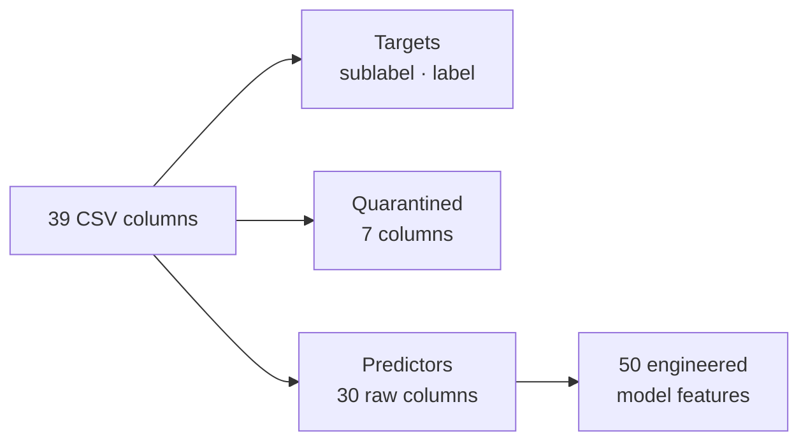

# Data Contract

This contract is what the training pipeline enforces on every batch and what
the API enforces on every request. It is implemented in `src/config.py`,
`src/data/validator.py` and `src/api/schemas.py`.

## Source dataset

| Property | Value |
| :-- | :-- |
| File | `data/Data Warehouse Multiclass.csv` (git-tracked, ~94 MB) |
| Rows / columns | 280,985 × 39 |
| Exact duplicates | 2,284 (dropped before splitting → 278,701 rows) |
| Missing values | 0 |
| Provenance | Three source studies (`hypertension`: 174,982 · `diabetes`: 96,128 · `heart`: 9,875) |

### Class distribution (`sublabel`)

| Sublabel | Rows | Share | Training weight |
| :-- | --: | --: | --: |
| `N` | 106,884 | 38.0% | 0.33 |
| `HY` | 69,806 | 24.8% | 0.50 |
| `DI_HY` | 66,473 | 23.7% | 0.52 |
| `DI` | 31,918 | 11.4% | 1.09 |
| `HT` | 2,595 | 0.9% | 13.49 |
| `DI_HT` | 1,398 | 0.5% | 24.91 |
| `HT_HY` | 1,066 | 0.4% | 32.73 |
| `DI_HT_HY` | 845 | 0.3% | 41.19 |

## Column roles

### Quarantined columns

> [!CAUTION]
> These columns must **never** enter the feature matrix. Including them gives
> a spurious ~1.00 F1, which is what earlier versions of this project reported.

| Column | Why it is excluded |
| :-- | :-- |
| `diabetes`, `hypertension`, `heart_disease` | Target clones or target-derived group probabilities |
| `disease_flags` | Comma-encoded `(DI, HT, HY)` indicators; the label itself |
| `label` | Binary target (Normal / Abnormal) |
| `composite_key` | Stratification group key built from demographics |
| `age_normalized` | Redundant pre-scaled copy of `age`, with scaling statistics from outside the training fold |
| `source_dataset` | Provenance; strongly separable (adversarial AUC 0.96), encodes the source study |

> [!IMPORTANT]
> The order of `disease_flags` is **(Diabetes, Heart disease, Hypertension)**,
> that is `(DI, HT, HY)`. For example, `DI_HT` is `"1,1,0"`.

## Validation rules (training batches)

Any **error** fails the pipeline before training starts. **Warnings** are
logged.

| Check | Rule | Severity |
| :-- | :-- | :-: |
| Schema | All 30 predictor columns and `sublabel` are present | Error |
| Nulls | No nulls in predictors or target | Error |
| Ranges | Numeric values within physiological bounds (see the [API spec](api-spec.md#numeric-fields)) | Error |
| Categories | Every categorical value is in the frozen level set | Error |
| Class presence | All 8 sublabels are present | Error |
| Class share | Each class is ≥ 0.1% of the batch | Warning |
| Duplicates | Exact duplicate rows (they are dropped) | Warning |
| Empty batch | — | Error |

## Feature contract

The pipeline turns the 30 raw columns into exactly these 50 features, in this
order. The list is identical to the research notebook's champion contract and is
asserted in `tests/test_features.py`.

| # | Group | Features | Scaled |
| --: | :-- | :-- | :-: |
| 1–21 | Ordinal + numeric | `age_level`, `bmi_level`, `age`, `bmi`, `HbA1c_level`, `glucose`, `cholesterol`, `sleep_hours`, `triglycerides`, `stress_level`, `blood_pressure`, `crp_level`, `homocysteine_level`, `systolic_bp`, `diastolic_bp`, `alcohol_intake`, `salt_intake`, `heart_rate`, `hdl`, `ldl`, `education_level` | ✅ |
| 22–25 | Clinical interactions | `pulse_pressure`, `mean_arterial_pressure`, `cholesterol_ratio`, `glucose_triglyceride_index` | ✅ |
| 26–37 | Imputation flags | `<col>_is_imputed` for `age`, `glucose`, `HbA1c_level`, `heart_rate`, `diastolic_bp`, `hdl`, `systolic_bp`, `ldl`, `salt_intake`, `cholesterol`, `alcohol_intake`, `triglycerides` | — |
| 38–50 | One-hot (first level dropped) | `gender_Male`, `smoking_Former`, `smoking_Never`, `physical_activity_Low`, `physical_activity_Moderate`, `family_history_Yes`, `low_hdl_cholesterol_Yes`, `high_ldl_cholesterol_Yes`, `high_blood_pressure_Yes`, `sugar_consumption_Low`, `sugar_consumption_Medium`, `employment_status_Retired`, `employment_status_Unemployed` | — |

### Engineered feature definitions

| Feature | Formula |
| :-- | :-- |
| `pulse_pressure` | `systolic_bp − diastolic_bp` |
| `mean_arterial_pressure` | `diastolic_bp + pulse_pressure / 3` |
| `cholesterol_ratio` | `ldl / (hdl + 1e-5)` |
| `glucose_triglyceride_index` | `ln(glucose × triglycerides + 1)` |
| `<col>_is_imputed` | `1` if the value equals the training-fold mode (±1e-5), else `0` |

> [!NOTE]
> The warehouse filled missing biomarkers with group means, so a value equal
> to the column mode is a strong signal that the value was imputed. The flags
> carry that "missingness" information to the model. Their modes are learned
> from the training fold only.

## Ordinal encodings

| Column | Mapping |
| :-- | :-- |
| `age_level` | Young 0 · Middle 1 · Mature 2 · Senior 3 |
| `bmi_level` | Underweight 0 · Normal 1 · Overweight 2 · Obese 3 |
| `stress_level` | Low 0 · Medium 1 · High 2 |
| `education_level` | Primary 0 · Secondary 1 · Tertiary 2 |

## Changing the contract

1. Update `src/config.py` (levels, columns) and `src/api/schemas.py` together.
2. Update `EXPECTED_FEATURES` in `tests/test_features.py`.
3. Retrain. The new `models/serving_contract.json` shows the change in review.
4. Treat it as a breaking API change (see the
   [API spec](api-spec.md#versioning--compatibility)).
