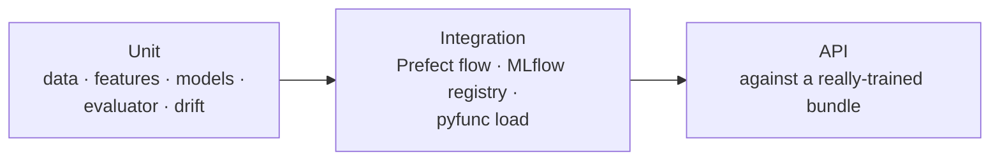
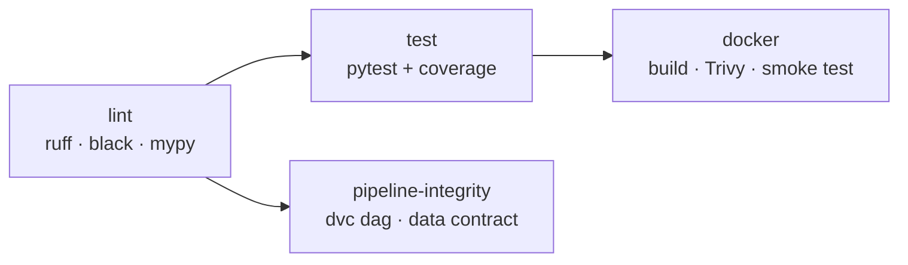

# Development Guide

## Setup

| Requirement | Version |
| :-- | :-- |
| [uv](https://docs.astral.sh/uv/) | 0.11+ (CI pins 0.11.14) |
| Python | 3.11 (installed by uv) |
| Docker | Optional, for the full stack |

```bash
uv sync                    # runtime + dev dependencies from uv.lock
uv run pre-commit install  # ruff, black, mypy and hygiene hooks on commit
```

> [!NOTE]
> Always use `uv run …` (or the `make` targets) so commands run against the
> locked environment. `uv sync --frozen` fails if `uv.lock` is out of date
> with `pyproject.toml`; that is the check CI runs.

## Everyday commands

| Command | What it does |
| :-- | :-- |
| `make lint` | `ruff check`, `black --check`, `mypy src flows` |
| `make format` | Auto-fix lint and formatting |
| `make test` | `pytest` with the 80% coverage gate (currently 97%) |
| `make train` | Full training flow on the real data (~2 min) |
| `make repro` | `dvc repro`: retrain only if data or code changed |
| `make serve` | API with autoreload on :8000 |
| `make drift BATCH=file.csv` | PSI drift report |
| `make mlflow-ui` | MLflow UI over `./mlflow.db` on :5000 |

## Tests



| File | Covers |
| :-- | :-- |
| `test_data.py` | Loader, `disease_flags` order, leakage quarantine, every validator rule, stratified split |
| `test_features.py` | The exact 50-feature contract, train-only fitting, single-row/batch parity, unknown levels |
| `test_models.py` | LightGBM weights/early stopping/threshold guard, IsolationForest, OCSVM subsampling |
| `test_evaluator.py` | Metrics, NaN-AUC handling, disease marginals, plots |
| `test_drift.py` | PSI maths, drift detection, CLI exit codes |
| `test_api.py` | Every endpoint, 422/503 paths, Prometheus format |
| `test_pipeline.py` | End-to-end flow, quality gate, champion/challenger promotion, registry loading |

> [!TIP]
> Use `tests/conftest.py::make_raw_frame(n, seed)` for test data. It produces
> the real 39-column schema with the real category levels and a learnable
> signal. Hand-built frames drift from the contract.

The session-scoped `trained_bundle_path` fixture trains one small real bundle
that the API and drift tests share. This is why the API tests exercise the
real inference path and not a mock.

## Conventions

- All code lives in `src/` and is imported as `from src.… import …`.
- Every function has type hints (mypy runs with `disallow_untyped_defs`).
- Paths and parameters come from `settings`; never hardcode them.
- Prefer docstrings to inline comments.
- Any statistic learned from data goes inside a `fit()` that only sees the
  training fold.

> [!CAUTION]
> Never add a column from the quarantine list (`settings.LEAKAGE_COLUMNS`) to
> the features. The test suite asserts the exact feature list, so an
> accidental addition fails CI.

## CI



| Workflow | Trigger | Purpose |
| :-- | :-- | :-- |
| `ci.yml` | Push / PR to `master` | The quality gates above |
| `release.yml` | CI success on `master`, `v*` tags | Build and push the image to GHCR |
| `retrain.yml` | Weekly, manual | Continuous training |
| Dependabot | Weekly | Actions, uv and Docker base-image updates |

> [!IMPORTANT]
> Keep MLflow at **3.11 or newer**. Older releases carry critical CVEs (path
> traversal, command injection, authentication bypass) that the Trivy gate
> rejects. Prefect must be **3.9 or newer**, because 3.8's server breaks on
> FastAPI 0.160+.

## Making changes

| Change | Also update |
| :-- | :-- |
| Model hyperparameters | `Settings.lgb_params`; compare runs in MLflow before merging |
| New feature or category | [Data contract](data-contract.md) steps; it is a breaking API change |
| New endpoint | `src/api/`, `tests/test_api.py`, [API spec](api-spec.md) |
| New metric | `flows/training_flow.py:evaluate`; it flows to MLflow and `reports/metrics.json` automatically |
| Dependency | `uv add <pkg>`, then commit `pyproject.toml` and `uv.lock` together |

Commit messages follow [Conventional Commits](https://www.conventionalcommits.org/)
(`feat:`, `fix:`, `docs:`, `refactor:`, `test:`, `ci:`, `chore:`).
