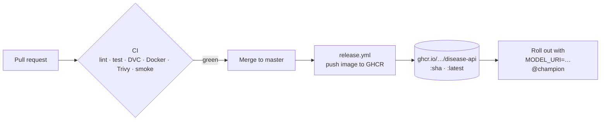

# Operations Runbook

Procedures for deploying, retraining, promoting and rolling back the model, and
for responding to alerts.

- [Environments & configuration](#environments--configuration)
- [Deploy](#deploy)
- [Retrain](#retrain)
- [Promote & roll back](#promote--roll-back)
- [Drift checks](#drift-checks)
- [Alerts](#alerts)
- [Troubleshooting](#troubleshooting)

---

## Environments & configuration

Every field of `src/config.py:Settings` can be overridden with an environment
variable of the same name (case-insensitive) or in `.env`.

| Variable | Default | Purpose |
| :-- | :-- | :-- |
| `MLFLOW_TRACKING_URI` | `file:<repo>/mlruns` | Tracking server / registry |
| `MODEL_URI` | *(unset)* | Serve from the registry, e.g. `models:/disease-anomaly-classifier@champion` |
| `MODEL_DIR` | `<repo>/models` | Local bundle location when `MODEL_URI` is unset |
| `MIN_TEST_MACRO_AUC` | `0.90` | Quality gate |
| `PSI_ALERT_THRESHOLD` | `0.25` | Drift alert threshold |
| `ENABLE_MLFLOW` | `true` | Disable tracking for offline runs |
| `ENVIRONMENT` | `development` | Tagged on every MLflow run |
| `POSTGRES_*`, `GRAFANA_ADMIN_PASSWORD` | see `.env.example` | Compose stack credentials |

> [!CAUTION]
> The defaults in `docker-compose.yml` and `.env.example` are for local use only.
> Set real secrets for any shared environment and keep `.env` out of git (it is
> already ignored).

## Deploy



1. Merge to `master`. After CI passes, `release.yml` pushes
   `ghcr.io/<owner>/<repo>/disease-api:<short-sha>` and `:latest`. A `v*` tag
   also publishes a semver tag.
2. Roll the image out with `MODEL_URI=models:/disease-anomaly-classifier@champion`
   and `MLFLOW_TRACKING_URI` pointing at the registry.
3. Gate traffic on `GET /ready`, which returns 503 until the model is loaded.
   Use `GET /health` as the liveness probe.
4. Verify:
   ```bash
   curl -s $HOST/health | jq .model_version
   curl -s -X POST $HOST/predict -H 'content-type: application/json' -d @docs/examples/patient.json
   ```

> [!TIP]
> The image and the model are versioned independently. Deploying new code does
> not change the model, and promoting a model needs only a restart (or a new
> pod) of the API.

Local stack:

```bash
cp .env.example .env
docker compose up -d --build
docker compose --profile train run --rm trainer
docker compose restart api
```

## Retrain

| Trigger | How |
| :-- | :-- |
| Scheduled | `retrain.yml` runs Mondays 03:00 UTC |
| On demand | *Actions → Continuous training → Run workflow* (optional `min_auc`) |
| Locally | `make train`, or `uv run dvc repro` (skips the run if nothing changed) |
| Drift alert | See [Drift checks](#drift-checks) |

Every run logs to MLflow and writes `reports/`. If the quality gate fails, the
process exits with code 3 and **nothing is registered**.

> [!NOTE]
> Without the `MLFLOW_TRACKING_URI` secret, the GitHub workflow trains against
> a throwaway local store and uploads `models/` and `reports/` as workflow
> artifacts. Set the secret to register into the shared registry.

## Promote & roll back

Promotion is automatic. Every new version gets `@candidate`, and it gets
`@champion` only when its `test_roc_auc_macro` is strictly higher than the
current champion's.

**Manual promotion or rollback** (for example, to an earlier version `N`):

```python
from mlflow import MlflowClient
MlflowClient().set_registered_model_alias(
    "disease-anomaly-classifier", "champion", "N"
)
```

Then restart the API pods. Confirm with `/health` → `model_version`.

> [!IMPORTANT]
> Record every manual promotion: set a tag on the model version, e.g.
> `client.set_model_version_tag(name, "N", "promoted_by", "<you>: <reason>")`.

## Drift checks

```bash
uv run python -m src.monitoring new_batch.csv --output reports/drift_new.json
echo $?   # 0 = stable, 2 = at least one feature with PSI ≥ 0.25
```

| PSI | Interpretation | Action |
| :-- | :-- | :-- |
| < 0.10 | Stable | None |
| 0.10 – 0.25 | Moderate shift | Investigate the source; watch the prediction mix in Grafana |
| ≥ 0.25 | Major shift | Confirm it is not a pipeline or unit bug, then retrain with the new data included |

> [!WARNING]
> Check the *Predicted sublabel mix* panel at the same time. A shifted input
> together with an unchanged prediction mix usually means a harmless shift. A
> shifted prediction mix with stable inputs suggests a change in the label
> relationship (concept drift), and that needs labelled data to confirm.

## Alerts

Defined in `prometheus_alerts.yml`.

| Alert | Severity | Condition | First response |
| :-- | :-: | :-- | :-- |
| `DiseaseApiDown` | 🔴 critical | Scrape target down for 2 min | Check container/pod status and logs; check `/health` |
| `DiseaseApiNoModel` | 🔴 critical | No `model_info` series for 5 min | Model failed to load: check `MODEL_URI`, registry reachability and the startup log line `Failed to load model bundle` |
| `DiseaseApiHighErrorRate` | 🟠 warning | > 5% of responses are 5xx for 5 min | Check logs for stack traces; roll back the image if a deploy just happened |
| `DiseaseApiSlowPredictions` | 🟠 warning | p95 `/predict` > 500 ms for 10 min | Check CPU saturation; scale out replicas; check batch sizes |

## Troubleshooting

| Symptom | Likely cause | Fix |
| :-- | :-- | :-- |
| `/ready` returns 503 | No bundle at `models/bundle.joblib` and no `MODEL_URI` | Train, or set `MODEL_URI` |
| `422` with `"Unknown levels for '…'"` | Client sent a category outside the contract | Fix the client; see the [data contract](data-contract.md) |
| Training fails with `Data validation failed` | Contract violation in the new CSV | The error lists the columns and counts; fix the upstream extract |
| `QualityGateError` | Model below `MIN_TEST_MACRO_AUC` | Inspect the MLflow run and the data; never lower the gate to force a release |
| `mlflow.pyfunc` schema error on `age` | Integer input while the signature expects double | Cast numeric columns to float (as the API does) |
| Prefect `IntegrityError … task_run_state` in logs | Prefect's ephemeral server event recorder | Harmless; point `PREFECT_API_URL` at a real Prefect server to avoid it |
| ~200 ms latency on Windows `localhost` | IPv6 → IPv4 fallback | Use `127.0.0.1`; real latency is ~13 ms |
